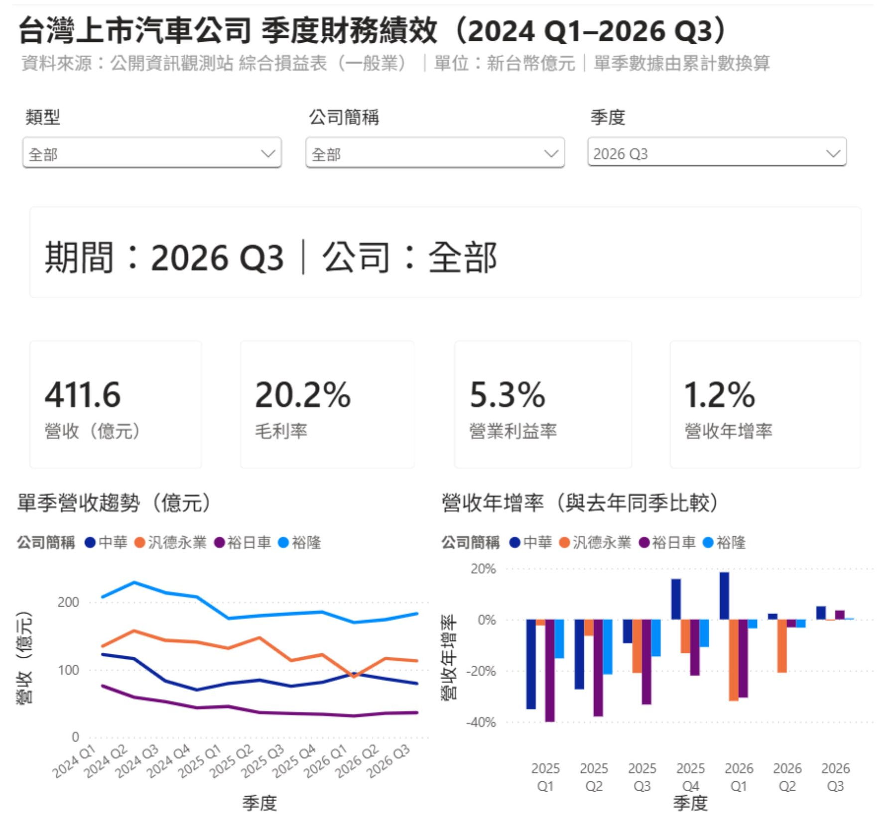
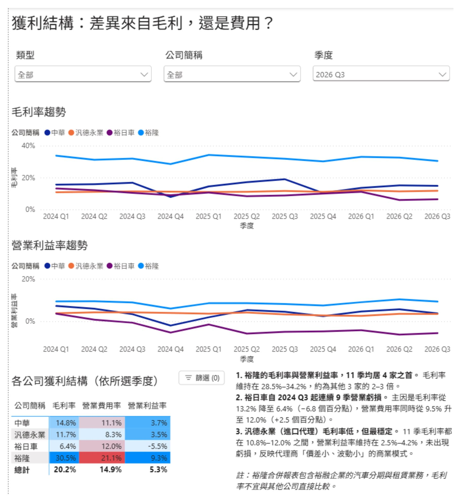

# 台灣上市汽車公司 季度財務績效儀表板

以 Power BI 建立的同業財務比較儀表板，比較 4 家台灣上市汽車公司 2024 Q1–2026 Q3 共 11 季的營收與獲利結構，模擬企業財務部（Controlling）的季度績效檢討報表。

> **English summary** — A Power BI peer-benchmarking dashboard covering 4 Taiwan-listed automotive companies over 11 quarters (2024 Q1–2026 Q3). Built with Power Query (folder-based ETL, encoding normalization, YTD-to-quarterly conversion via self-merge), a star-schema data model, and DAX measures (margins, YoY growth with `SAMEPERIODLASTYEAR`). Data: TWSE Market Observation Post System (MOPS) quarterly income statements.

## 儀表板畫面

**第 1 頁：總覽**：單季營收、毛利率、營業利益率、營收年增率，以及各公司營收趨勢



**第 2 頁：獲利結構**：各公司的獲利差異來自毛利還是費用



## 分析對象

| 公司 | 代號 | 類型 |
|---|---|---|
| 裕隆 | 2201 | 國產製造 |
| 中華 | 2204 | 國產製造 |
| 裕日車 | 2227 | 國產品牌 |
| 汎德永業 | 2247 | 進口代理（BMW） |

選入一家進口代理商作為對照組，比較製造商與代理商在獲利結構上的差異。和泰車（2207）的損益表不在「一般業」格式中，因此未納入。

## 資料來源

- 公開資訊觀測站 → 彙總報表 → 綜合損益表（一般業），113 年 Q1 至 115 年 Q3，共 11 份 CSV（`data/` 資料夾）
- 單位：新台幣千元；儀表板以億元呈現

## 資料處理流程

### 1. 編碼統一
原始檔案中 10 份為 Big5、1 份（115 年 Q3）為 UTF-8。Power Query「從資料夾」合併時只能套用單一編碼，因此先將 11 份統一轉為 UTF-8。

### 2. 合併與篩選（Power Query）
- 以「從資料夾」一次合併 11 份檔案，新增一季時只需放入新檔並重新整理
- 篩選 4 家公司，保留營收、成本、毛利、營業費用、營業利益、淨利等欄位
- 以民國年與季別建立季末日期，例如 113 年 Q2 → 2024/6/30

### 3. 累計數換算單季數
公開資訊觀測站的季度損益為**年度累計數**，例如 Q2 數字為上半年合計。若直接使用，趨勢圖會呈現每年 Q1 驟降、Q4 驟升的假象。

處理方式：
1. 建立「前季」欄位（Q1 為 null，Q2 為 1，依此類推）
2. 將資料表**與自身合併**（依 年度 + 公司代號 + 前季 ↔ 年度 + 公司代號 + 季別），取得上一季累計數
3. 單季數 = 本季累計 − 前季累計（Q1 無前季，直接等於累計數）

**驗算：** 裕隆 2024 年四季單季營收加總 = 2024 Q4 累計數（857.8 億元）。

## 資料模型

星狀結構：

```
            日期表
              │ 1
              ▼ *
公司 ──1──▶ 財報（事實表：每家公司每季一列）
       *
```

- **財報**：事實表，44 列（4 家 × 11 季）
- **公司**：維度表，含「類型」分類，供篩選使用
- **日期表**：以 DAX `CALENDAR` 建立並標示為日期表，供時間智慧函數使用
- 關聯皆為多對一、單向篩選

## DAX 量值

| 量值 | 公式重點 |
|---|---|
| 營收、毛利、營業費用、營業利益 | `SUM` 單季欄位 |
| 毛利率、營業費用率、營業利益率 | `DIVIDE`，分母為 0 時回傳空白 |
| 營收年增率 | `CALCULATE` + `SAMEPERIODLASTYEAR('日期表'[Date])` |
| 篩選說明 | `SELECTEDVALUE`、`CONCATENATEX`，動態顯示目前篩選的期間與公司 |

```DAX
營收年增率 =
VAR CurrentRev = [營收]
VAR LastYearRev = CALCULATE([營收], SAMEPERIODLASTYEAR('日期表'[Date]))
RETURN DIVIDE(CurrentRev - LastYearRev, LastYearRev)
```

## 主要發現

1. **營收全面下滑**：4 家公司 2026 年前三季營收均低於 2024 年同期，降幅介於 19%（裕隆、中華）至 45%（裕日車）。
2. **裕隆的毛利率與營業利益率 11 季均居 4 家之首**，毛利率維持在 28.5%–34.2%，約為其他 3 家的 2–3 倍。
3. **裕日車自 2024 Q3 起連續 9 季營業虧損**。主因是毛利率從 13.2% 降至 6.4%（−6.8 個百分點），營業費用率同時從 9.5% 升至 12.0%（+2.5 個百分點）。
4. **汎德永業（進口代理）毛利率低但最穩定**。11 季毛利率介於 10.8%–12.0%，營業利益率維持在 2.5%–4.2%，未出現虧損，反映代理商「價差小、波動小」的商業模式。

## 限制

- **裕隆合併報表包含裕融企業**（汽車分期付款與租賃業務），毛利率與費用率不宜與其他公司直接比較。
- 「營業毛利（毛損）淨額」包含關係企業間未實現／已實現銷貨損益調整，因此不必然等於營收減營業成本。
- 2024 年無前一年度資料，營收年增率自 2025 Q1 起才有數值。
- 樣本僅 4 家公司，未涵蓋未上市的進口車代理商。

## 檔案說明

| 檔案 | 說明 |
|---|---|
| `taiwan_auto_financial_dashboard.pbix` | Power BI 檔案（需 Power BI Desktop 開啟） |
| `data/` | 11 季綜合損益表 CSV（已轉為 UTF-8） |
| `images/` | 儀表板截圖 |

## 使用工具

Power BI Desktop（Power Query、DAX）、Python（編碼轉換）
